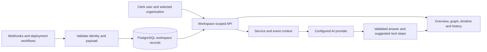

# How Context fits together

An event reaches Context with a service name and a timestamp. The API validates the delivery, places it in the right workspace, and saves it. When someone opens the dashboard, the server reads the current service records and nearby activity, builds dependency and risk views, and returns the evidence needed for an investigation.

This guide follows that path from delivery to the screen. It describes the current implementation, including the parts that remain heuristic or limited to recent activity.

## The route through the system



The dashboard is a React 19 application built with Vite 7. Express 5 serves the API, and the production server also serves the built dashboard. TypeScript 5.9 describes the contracts. Drizzle maps the relational schema to PostgreSQL. Clerk handles sign-in and organization membership.

## A workspace is the data boundary

A signed-in request resolves the user and selected Clerk organization before reading workspace records. A personal workspace stays separate from a selected shared team. Choosing a team does not move personal services or documents into it.

Shared mutations require `org:admin`. Members may read the incident workspace, ask AI questions, and request illustrative remediation previews. The Engineer/SRE/Manager selector controls presentation and the audience of new AI answers; it does not control authorization.

External ingestion uses generated webhook keys. The database stores the key's digest and display prefix. Shared-key delivery also checks whether its issuing user is still an admin in the team. A failed membership check rejects the delivery.

## Evidence arrives through a small set of routes

All paths below begin with `/api`.

| Method and path | Purpose |
| --- | --- |
| `POST /upload/services` | Save service definitions and directional dependencies. |
| `POST /upload/events` | Save service event records through an authenticated session. |
| `POST /upload/messages` | Save team or operational messages. |
| `POST /ingest/webhook` | Accept a generic alert or event using an ingestion key. |
| `POST /ingest/webhook/pagerduty` | Accept PagerDuty V3 or supported legacy envelopes. |
| `POST /ingest/github-actions` | Save deployment evidence without changing service health. |
| `GET /webhook-keys` | List key metadata for the selected workspace. |
| `POST /webhook-keys` | Create a named ingestion key; return its secret once. |
| `DELETE /webhook-keys/:id` | Revoke a workspace key. |

A generic event may carry `eventId` and `occurredAt`. Stable IDs make redelivery recognizable. GitHub deployment identity includes repository, run, attempt, service, environment, and status, keeping reruns and matrix services distinct.

Service uploads reuse a name within the selected workspace. An update changes only the supplied fields, including optional ownership and criticality; omitting status keeps the recorded health. Dependencies name another service in that workspace, including an existing service outside the upload. Invalid dependencies roll back the batch. Service names are case-sensitive.

Event batches apply health updates in their supplied order and commit together. A later storage failure rolls back earlier records and health changes. A deployment failure records the deployment result without declaring the service unhealthy. Message and document batches also commit together.

## The dashboard assembles a reading path

`GET /insights/summary` combines service health, risks, root-cause analysis, predictions, dependency edges, and recent activity. Its `limit` is an integer from 1 to 100. Events and messages in this summary are taken from the recent 48-hour window.

The individual `/insights/risks`, `/insights/root-cause`, `/insights/predictions`, `/insights/graph`, and `/insights/timeline` routes remain available. Timeline also accepts an integer `limit` from 1 to 100, defaulting to 40. Equal-timestamp activity is ordered by database identity within each source.

| Surface | How it interprets the records |
| --- | --- |
| Overview | Current health first, followed by the work relevant to the selected audience. |
| Graph | An arrow from a caller to a dependency. Cycles are handled when arranging the diagram. |
| Timeline | Recorded chronology with source, category, timestamp, and optional evidence details. |
| History | Activity windows built from the loaded feed. It is not an independently paginated archive of all stored events. |
| AI | A question answered from the workspace's service, dependency, event, and message context. |

Highlights preserve the first and latest records per service/category within each activity window, all critical records, all team communications, and records with unavailable timestamps. All activity exposes the complete loaded feed.

Recovery classification recognizes explicit reports while avoiding negated or conditional statements. A rollback recommendation remains investigation evidence; it does not mean a rollback ran.

Risk and prediction outputs are heuristics. Model confidence is a generated assessment, not a measured guarantee of causality. The Manager briefing does not infer customer counts, revenue loss, or a recovery ETA from health badges.

Both prediction endpoints use the same dependency and alert evidence. They report failure timing as unestimated. Root-cause financial impact remains unknown without measured inputs. Automated signals describe observed patterns; repeated failures do not establish a retry storm, and several unhealthy services do not establish a cascade. Postmortems are provisional and identify missing evidence for duration, closure, ownership, and impact.

## AI explains the collected context

`POST /ai/incident-ask` accepts a question and an optional audience: `engineer`, `sre`, or `manager`. The default is SRE. The server chooses audience instructions and validates the structured response before returning it in the usual `{ success, data, error }` envelope.

The API supports Gemini and OpenAI configuration. Gemini can use the native transport or the OpenAI-compatible endpoint. Provider attempts are bounded; rate limits, timeouts, and temporary failures produce safe error messages.

An AI conversation mounts on the first visit and stays mounted while another tab is open. Workspace changes abort pending requests and clear the previous workspace's conversation. An earlier answer keeps the audience it was generated for when the user switches views.

`POST /insights/simulate-action` returns an illustrative preview. It does not execute a command or write a recovery event. The nine-step demo is a separate synthetic workflow that does write test service and activity records.

## Onboarding has its own saved context

Document and team-directory uploads support onboarding briefs. These API capabilities share the same workspace boundary but use separate brief roles: `backend`, `frontend`, and `pm`.

| Route | Purpose |
| --- | --- |
| `POST /upload/docs` | Save workspace knowledge for later reads and generation. |
| `POST /upload/team` | Save directory contacts; this does not grant Clerk membership. |
| `POST /generate-brief` | Queue a brief or reuse an active matching job. |
| `GET /brief/live`, `GET /brief/:id` | Read an owned brief in the current workspace. |
| `GET /context/brief` | Read the latest saved brief for the requested onboarding role. |
| `GET /context/team`, `GET /team` | Read uploaded directory data. |
| `GET /context-graph`, `GET /context/documents` | Read workspace document context. |

Brief workers scan pending work at startup and periodically afterward. Session advisory locks coordinate replicas. The configured limit is four active jobs per process and two per tenant per process. Workers therefore need a direct PostgreSQL connection or a session pooler; transaction pooling cannot preserve those session locks.

## What is stored

The schema lives in `lib/db/src/schema`.

| Records | Tables |
| --- | --- |
| Accounts and workspace mapping | `users`, `organizations`, `refresh_tokens` |
| Incident services and dependencies | `services`, `service_dependencies` |
| Event and communication evidence | `service_events`, `service_messages` |
| Ingestion credentials | `webhook_keys` |
| Onboarding knowledge and jobs | `documents`, `context_briefs` |
| Conversation storage | `conversations`, `messages` |

The browser's incident conversation uses local component state; these conversation tables are not a persistence guarantee for that dashboard chat.

Initialization creates the current schema only in an empty database. Versioned migrations upgrade an existing installation and record checksums. [Setup and deployment](DEPLOYMENT.md) gives the commands and rollback sequence.

## Find the implementation

```text
artifacts/
  api-server/         Express routes, authorization, workers and provider calls
  context-app/        Dashboard, landing page and incident demo
lib/
  db/                 Schema, bootstrap, migrations and database tests
  api-spec/           OpenAPI definitions and generation configuration
  api-client-react/   Generated client contracts and hooks
  api-zod/            Generated validation contracts
  integrations-openai-ai-server/  Shared provider and transport utilities
scripts/              Local setup, release preparation and verification
deployment/           Compose, HTTPS proxy and production environment template
examples/             GitHub Actions reporting workflow
```

The generated OpenAPI packages cover their declared endpoints. Several incident routes are consumed directly by the dashboard, so their route source and tests remain the reference for behavior.
